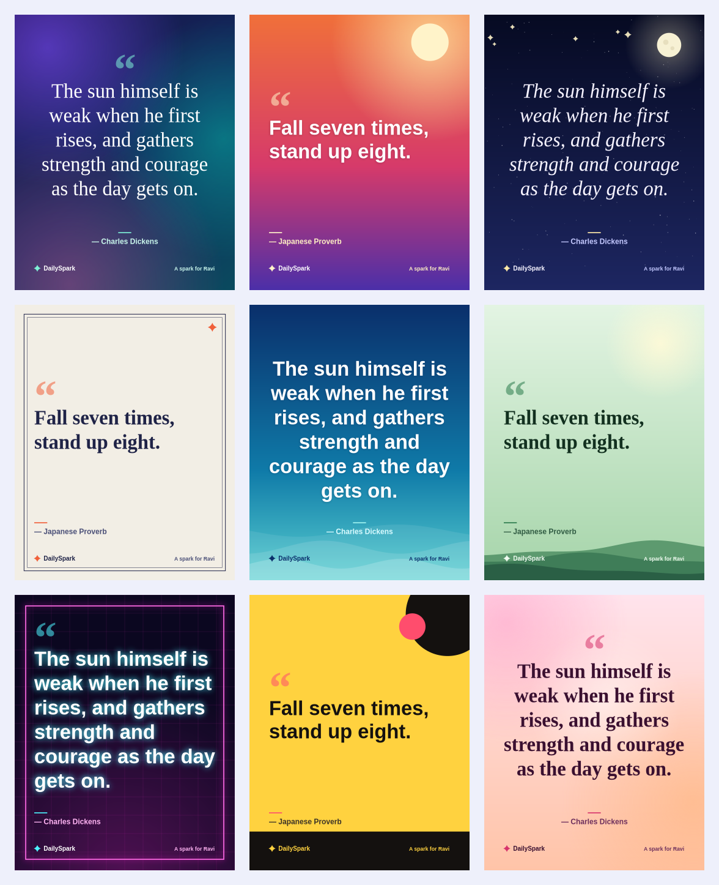

# DailySpark

**A personal motivational quote for every person, every day, matched to how you feel.**

DailySpark pulls quotes from several online sources, tags them by theme, and picks **one quote per person per day**. The pick depends on your anonymous ID, today's date, your mood and your interests, so two people never get the same stream of quotes. Every quote can be turned into a shareable image card with one of 9 designed templates.



## Features

- **Personal daily quote.** The same person sees the same quote all day, and a different one tomorrow.
- **Mood-aware.** Choose *Ready to go, Low on energy, Anxious, Scattered, Feeling low,* or *Stuck*. You get a matching quote and a small "Try this today" action.
- **Live quote sources.** ZenQuotes, Quotable, DummyJSON and Type.fit, merged with 84 curated quotes. Quotes are de-duplicated, length-checked, filtered for positivity and auto-tagged by theme.
- **Works offline.** If every online source is down, the app keeps serving the curated list. It never crashes because an API did.
- **Card studio.** 9 templates (Aurora, Sunrise, Midnight, Linen, Ocean, Forest, Neon, Sunbeam, Blush) in square, portrait and story shapes. Download as PNG, copy, share, or listen.
- **Streak and favourites.** Saved in your browser only.
- **Light and dark mode**, keyboard accessible, mobile friendly.
- **Private by design.** No accounts and no tracking. Your name, mood and favourites never leave your browser. The server only sees a random ID.

## Quick start

Requires Python 3.10 or newer.

```bash
git clone https://github.com/your-username/dailyspark.git
cd dailyspark

python -m venv .venv
source .venv/bin/activate        # Windows: .venv\Scripts\activate
pip install -r requirements.txt

python run.py
```

Open **http://127.0.0.1:8000**. API docs are at `/docs`.

### Run with Docker

```bash
docker build -t dailyspark .
docker run -p 8000:8000 dailyspark
```

### Run the tests

```bash
pip install -r requirements-dev.txt
pytest
```

The tests never touch the internet.

## How personalisation works

```
seed = sha256(user_id | date | mood | interests)
pool = quotes whose themes match the mood (then your interests)
pool = pool minus the quotes you saw in the last 14 days
quote = pool[seed % len(pool)]
```

| Mood | Themes it draws from |
|---|---|
| Ready to go | success, motivation, courage |
| Low on energy | resilience, positivity, calm |
| Anxious | calm, courage, wisdom |
| Scattered | focus, wisdom, motivation |
| Feeling low | positivity, resilience, calm |
| Stuck | courage, motivation, resilience |

The browser also caches today's quote per mood, so it never changes under you when the quote pool grows.

## API

| Endpoint | Description |
|---|---|
| `GET /api/daily?uid=&mood=&interests=&date=&exclude=` | The person's quote for the day |
| `GET /api/random?uid=&mood=&nonce=` | An extra quote |
| `GET /api/moods` | Moods and themes |
| `GET /api/stats` | Pool size per source |
| `POST /api/refresh` | Fetch fresh quotes in the background |
| `GET /api/health` | Health check |

Example:

```bash
curl "http://127.0.0.1:8000/api/daily?uid=demo-user-01&mood=tired"
```

## Project structure

```
dailyspark/
├── app/
│   ├── main.py          # FastAPI app and routes
│   ├── config.py        # settings from environment variables
│   ├── sources.py       # online quote APIs and their parsers
│   ├── store.py         # quote pool, caching, background refresh
│   ├── classifier.py    # theme tagging and safety filter
│   ├── picker.py        # personalised, deterministic selection
│   ├── moods.py         # moods, themes, micro-actions
│   ├── data/quotes.json # curated seed quotes
│   └── static/          # frontend (HTML, CSS, JS, card generator)
│       └── js/cards.js  # canvas card templates
├── tests/
├── docs/templates.png
├── Dockerfile
├── requirements.txt
└── run.py
```

## Configuration

| Variable | Default | Meaning |
|---|---|---|
| `HOST` / `PORT` | `127.0.0.1` / `8000` | Where the server listens |
| `DAILYSPARK_ONLINE` | `1` | Set to `0` to use only curated quotes |
| `DAILYSPARK_REFRESH_HOURS` | `12` | How often to pull fresh online quotes |
| `DAILYSPARK_TIMEOUT` | `6` | Seconds to wait for each online source |

Fetched quotes are cached in `app/data/cache/` (git-ignored).

## Add a quote or a card template

- **Quote:** add an entry to `app/data/quotes.json` with `text`, `author` and 1-2 `categories`, then open a pull request.
- **Card template:** add a background function and an entry to `TEMPLATES` in `app/static/js/cards.js`. Each template sets its font, colours and alignment, and the renderer handles text fitting.
- **Source:** add a `parse_*` function and a `Source(...)` line in `app/sources.py`.

## Deploy

Any host that runs Python or Docker works (Render, Railway, Fly.io). Start command:

```bash
uvicorn app.main:app --host 0.0.0.0 --port $PORT
```

## Credits

Quotes belong to their authors and are provided by public APIs. Please check each API's terms before commercial use. Fonts: Fraunces and Plus Jakarta Sans via Google Fonts.

## License

MIT. See [LICENSE](LICENSE).
